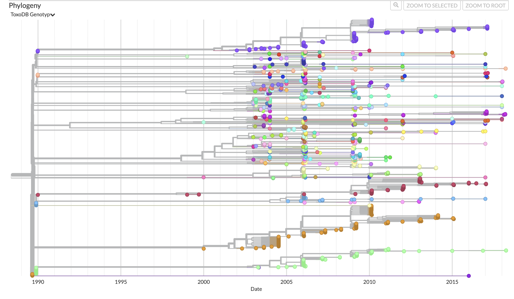

# Toxoplasma gondii PCR-RFLP Genotype Tree

A time-scaled genotype-similarity tree of **1,662 *Toxoplasma gondii* isolates** from 35
countries and 35 host species, built with [Nextstrain](https://nextstrain.org). *T. gondii*
is a protozoan parasite, so this pipeline is an adaptation of Nextstrain's viral tooling to
multilocus PCR-RFLP genotypes, each encoded as a 297 bp concatenated sequence. It is not a
rooted strain phylogeny; see [Caveats](#caveats).

Sachi Ramachandran and Dr. Chunlei Su · University of Tennessee, Knoxville · MICR 493

## Live visualization

**[View the interactive tree →](https://nextstrain.org/community/sachiramachandran/toxoplasma-gondii-analysis)**



## What this build adds

Nextstrain's standard builds track RNA viruses: whole genomes, thousands of variable sites,
a strong molecular clock, and metadata that stops at date and location. Applying that
machinery to *T. gondii* required rebuilding most of those assumptions, and the result
carries several things a stock build does not.

**Sequence-coded PCR-RFLP genotypes that carry full isolate metadata.** Each ToxoDB
genotype is encoded as a 297 bp sequence: fixed sequence codes for its alleles at 11
PCR-RFLP markers, concatenated in a fixed order (see *Marker coding* below). The dataset
holds one such sequence per genotype (212 genotypes), expanded across all 1,662 isolates via
the genotype key. That expansion is what lets one tree carry host species, geography,
serology, and mouse virulence simultaneously, rather than being a bare similarity
dendrogram.

**A quantified New World / Old World diversity gradient.** *T. gondii* is famously clonal
in the northern hemisphere and wildly diverse in South America. This build puts numbers on
it:

| Region | Isolates | Distinct ToxoDB genotypes |
|---|---:|---:|
| South America | 610 | **155** |
| North America | 494 | 39 |
| Africa | 185 | 10 |
| Asia | 111 | 9 |
| Europe | 88 | **6** |
| Central America | 81 | 17 |
| Caribbean | 47 | 12 |

610 South American isolates yield 155 genotypes; 88 European isolates yield six. The
gradient is visible directly in the tree's branching structure, not just in a summary table.

**Mouse virulence mapped onto the tree.** `mortality_percent` is exposed as a
continuous coloring across the 872 isolates with a recorded value — a virulence axis no
stock Nextstrain build has. It separates genotypes sharply:

| ToxoDB genotype | Isolates scored | Mean mouse mortality |
|---|---:|---:|
| #6 | 29 | **89.0%** |
| #13 | 35 | 22.9% |
| #8 | 21 | 13.9% |
| #7 | 19 | 13.2% |
| #1 | 62 | 3.6% |
| #2 | 81 | 1.2% |
| #3 | 110 | **0.0%** |
| #9 | 23 | 0.0% |

**Serology alongside sequence.** MAT titer is a second continuous coloring, covering 1,099
isolates, so serologic response can be read against genotype and host on the same tree.

**A reference with no coding region.** The reference is the ToxoDB genotype #1 sequence
(`config/reference_genotype1.gb`, 297 bp). Because the concatenated allele codes have no
reading frame, the build has no `translate` step and reports nucleotide changes only; the
diversity panel uses positions 1–297. `augur refine` runs at a clock rate of
8×10⁻⁴ ± 2×10⁻⁴ with `--keep-root` and `--clock-filter-iqd 4`, replacing the tutorial's
whole-genome RNA-virus defaults.

### Marker coding

Each 297 bp sequence joins the allele codes for these markers, in this order:

| Marker | Positions | Informative sites |
|---|---|---:|
| SAG1 | 1–22 | 2 |
| 5′-3′ SAG2 | 23–44 | 2 |
| alt. SAG2 | 45–77 | 3 |
| SAG3 | 78–99 | 3 |
| BTUB | 100–121 | 2 |
| GRA6 | 122–143 | 2 |
| c22-8 | 144–176 | 3 |
| c29-2 | 177–209 | 3 |
| L358 | 210–231 | 2 |
| PK1 | 232–275 | 5 |
| Apico | 276–297 | 2 |

The codes come from the *RFLP genotypes to sequence (SeqCoded)* workbook maintained by
Dr. Chunlei Su. Codes for unique alleles (`u-1`, `u-2`, `u-3`) are pseudo-sequences that
only mark a different allele, and untyped markers (`nd`) are dashes, which `augur align`
turns into `N`.

## Dataset at a glance

| | |
|---|---|
| Isolates | 1,662 |
| Sequence | 11 PCR-RFLP markers, concatenated allele codes, 297 bp (29 informative sites) |
| ToxoDB RFLP genotypes | 212 |
| Countries | 35 (9 regions, 277 localities) |
| Host species | 35 — Chicken 611, Cat 329, Pig 220, Dog 94, Feral Pig 75, Sheep 61, … |
| Collection years | 1989–2018 |
| Source publications | 53 |
| MAT titer recorded | 1,099 isolates |
| Mouse mortality recorded | 872 isolates |

## How the pipeline works

Defined in [`Snakefile`](Snakefile) at the repository root. Each rule is a standard `augur`
command:

| Rule | What it does | Output |
|---|---|---|
| `index_sequences` | Index sequence composition for filtering | `results/sequence_index.tsv` |
| `filter` | Apply exclusions and sampling thresholds | `results/filtered.fasta` |
| `align` | Align to the genotype #1 reference, filling gaps with N, then drop the reference | `results/aligned.fasta` |
| `tree` | Infer the maximum-likelihood tree | `results/tree_raw.nwk` |
| `refine` | Fit the molecular clock, infer node dates | `results/tree.nwk` |
| `ancestral` | Reconstruct ancestral nucleotide states | `results/nt_muts.json` |
| `traits` | Infer ancestral country assignments | `results/traits.json` |
| `export` | Assemble everything for Auspice | `auspice/toxoplasma-gondii-analysis.json` |

`data/toxoplasma_sequences.fasta` is a committed input, not a build product. It was produced
once by expanding the 212 genotype sequences in `old_data_backup/toxo_expansion.txt` across
the 1,662 isolate IDs in `old_data_backup/toxo_rflp_1662_metadata.tsv`, keyed on ToxoDB
genotype. Every FASTA header matches a `strain` value in `data/toxo_meta3.tsv` exactly —
that linkage is what the whole build rests on.

## Running it

Install the [Nextstrain CLI](https://docs.nextstrain.org/en/latest/install.html), then set
up a runtime once:

```bash
nextstrain setup docker
```

Build from the repository root:

```bash
nextstrain build --docker .
```

The published build was made with Nextstrain CLI 10.2.1 and the Docker image
`nextstrain/base:build-20250917T234053Z`, which provides Augur 31.5.0, Auspice 2.66.0,
TreeTime 0.11.4, IQ-TREE 3.0.1 and Snakemake 9.6.2. Newer images can change Augur's
behavior, so to reproduce it exactly, pin the image:

```bash
nextstrain build --docker --image nextstrain/base:build-20250917T234053Z .
```

View the result locally:

```bash
nextstrain view auspice/
```

The Snakefile lives at the repository root rather than inside `toxo-analysis/` for a
specific reason: nextstrain.org serves community builds from `auspice/<repo-name>.json` on
the default branch, and the Docker runtime mounts only the build directory. A Snakefile
inside `toxo-analysis/` could not write to the root `auspice/` at all. **`auspice/` is
deliberately tracked in git** — deleting it takes the published visualization offline.

To regenerate the geography and color configs after changing the metadata:

```bash
python3 toxo-analysis/scripts/build_lat_longs.py && python3 toxo-analysis/scripts/build_colors.py
```

## Repository layout

```
Snakefile                     the build; run from here
auspice/                      published JSON — tracked, served by nextstrain.org
docs/                         README images
toxo-analysis/
  config/
    reference_genotype1.gb    reference: ToxoDB genotype #1, 297 bp, no coding region
    annotations.json          nucleotide coordinates (1–297) passed to augur export
    ToxoplasmaOutgroup.gb     GRA6 (GenBank AF239291), from the 38-sample pilot; unused
    auspice_config.json       titles, colorings, geo resolutions, panels
    colors.tsv                generated — all 6 categorical colorings
    lat_longs.tsv             generated — country, region, city
    place_anchors.tsv         authoritative coordinates for 10 localities whose
                              recorded coordinates contradict their label
    dropped_strains.txt       exclusion list (currently empty)
  data/                       exactly the Snakefile's two inputs
    toxoplasma_sequences.fasta   1,662 marker sequences
    toxo_meta3.tsv               1,662 isolates, the build's metadata
  old_data_backup/            superseded inputs and provenance records, read by
                              nothing in the build:
    Toxo RFLP 1662 samples with coordinates.tsv   original upstream export
    toxo_expansion.txt           351 genotype -> marker sequence rows
    toxo_rflp_1662_metadata.tsv  isolate ID -> genotype mapping
    toxo_rflp_1662_metadata_trimmed.tsv  same rows with padding stripped; header still
                                 malformed, superseded by data/toxo_meta3.tsv
    toxo_meta2.csv, toxoplasma_metadata.tsv, toxoplasma_metadata_OLD.tsv
    book2_sequence_OLD.fasta, toxoplasma.fasta, samples_1, samples_2
  envs/nextstrain.yaml           conda environment, for running augur directly
  scripts/
    build_lat_longs.py        derives lat_longs.tsv from the metadata coordinates
    build_colors.py           derives colors.tsv from the metadata categories
  results/, logs/             generated, gitignored
```

`old_data_backup/Toxo RFLP 1662 samples with coordinates.tsv` is the original upstream
export, kept unmodified as a provenance record. Nothing in `old_data_backup/` is read by the
Snakefile or by either script.

## Adapting this to another dataset

Five inputs need replacing. The details below are where this build originally went wrong,
so they are worth reading closely.

**`metadata.tsv`** — one row per isolate. Must include `strain`, `country`, and `date`.
Column names are case-sensitive and must be lowercase to match the config files. Any column
you want to color or filter by needs a matching entry in `auspice_config.json`.

**`sequences.fasta`** — headers must match the metadata `strain` column *exactly*. A
mismatch here silently drops isolates from the build.

**`reference.gb`** — a GenBank record of a sequence from the same marker system as your
data. If the sequences are a real gene, annotate its CDS and add a `translate` rule to get
amino acid changes. If they are concatenated or coded markers, as here, leave the CDS out
and supply nucleotide coordinates through a file like `config/annotations.json`. Aligning to
a reference from a different gene still produces output, so check that the reference
actually matches your sequences.

**`colors.tsv`** — three tab-separated columns: `<metadata column>`, `<value>`, `<hex>`.
The column name must match the metadata header exactly, **lowercase included**. Writing
`Country` where the metadata says `country` causes augur to match nothing and Auspice to
silently fall back to auto-assigned colors — with no warning.

**`lat_longs.tsv`** — four tab-separated columns: `<metadata column>`, `<value>`,
`<latitude>`, `<longitude>`. One row per *location value*, not per isolate. Augur has a
built-in country list it falls back to, so an ignored file looks like a working map with
some countries mysteriously missing.

Both config files are generated here rather than hand-maintained, precisely because both
failure modes above are silent. If your metadata carries per-isolate coordinates, adapt
`scripts/build_lat_longs.py` and `scripts/build_colors.py` — they guarantee coverage by
construction.

Then update the path constants at the top of the `Snakefile` and the `colorings` /
`geo_resolutions` in `auspice_config.json`.

## Caveats

These bound every claim above and are worth stating plainly.

- **Coded alleles, not sequenced DNA.** The 297 bp sequences encode PCR-RFLP allele calls
  at 11 markers; codes for unique alleles are pseudo-sequences. Branch lengths therefore
  count allele differences, not real substitutions, and the tree is a genotype-similarity
  tree rather than a strain phylogeny. *T. gondii* recombines, which a tree cannot fully
  represent.
- **Identical sequences by construction.** Isolates sharing a ToxoDB genotype have the same
  marker sequence, because sequences were expanded from a per-genotype representative. Tip
  clustering therefore reflects sampling effort as much as evolutionary relationship, and
  clade sizes should not be read as population sizes.
- **The tree has no root.** There is no ancestral genotype or outgroup to root a tree of
  coded alleles, so the displayed root is not biological. It is wherever IQ-TREE placed it,
  kept by `augur refine --keep-root`, and it falls among genotype #1 isolates. Do not read
  the root position or the order of the deepest branches as ancestry.
- **The time axis is weakly informed.** A molecular clock fit to 29 informative sites over a
  29-year window carries little signal, and the root date sits at the earliest samples
  because the tree has no real root. Read the dating as relative ordering, not calendar dates.
- **No transmission lines on the map.** Isolates of the same genotype carry identical
  sequences, so ancestral country reconstruction joins countries that share a genotype. Those
  lines would show shared genotypes, not transmission events, so the map shows only the
  genotype mix at each location (`"transmission_lines": false` in `auspice_config.json`).
  Viewers can still switch them on in Auspice.
- **Most coordinates are approximate.** 1,495 of 1,662 isolates carry `GIS-proxy`
  coordinates — country or region centroids — against 167 marked `GIS-exact`. This is
  exposed as the *Coordinate Precision* coloring so it is visible while reading the map.
- **Two filter thresholds are inherited no-ops.** `--min-date 1908` and
  `--sequences-per-group 500` come from the Zika tutorial; with dates spanning 1989–2018
  and no year exceeding 500 isolates, all 1,662 pass. They are kept so the thresholds are
  explicit if the dataset grows.
- **Some location labels are not countries.** `Plateau` is a Nigerian state, `Svalbard` a
  Norwegian territory, and `Congo` and `St. Kitts` are ambiguous short forms. These are
  kept as recorded rather than reinterpreted, and are mapped by explicit coordinates
  derived from the isolates themselves.
- **Ten localities are positioned from an anchor, not from their isolates.** Augur never
  reads the metadata's `Latitude`/`Longitude`; it places every deme from
  `config/lat_longs.tsv`, keyed on the `country`/`region`/`city` label. Where the recorded
  coordinates contradict that label, the label wins and the position comes from
  `config/place_anchors.tsv`, leaving the metadata untouched. Most are plain typos — seven
  Venezuelan isolates record latitude `90.42` for `9.42`, eight Guangzhou isolates record
  longitude `133.25` for `113.25`, and four isolates drop a minus sign, which had put one
  Canadian isolate in northeastern China and one Portuguese isolate in Sardinia.
  `Massachusetts` is a judgement call worth knowing about: 29 of its 82 isolates carry
  Pennsylvania coordinates, and the deme is placed in Massachusetts because the label is
  treated as authoritative. `build_lat_longs.py` aborts on any out-of-range centroid, on any
  unanchored city whose isolates scatter more than 2°, and on any unanchored city that would
  land more than 10° closer to its own country with a sign flipped or the pair swapped —
  that last check is what catches a single-isolate city, where there is no spread to measure.
- **Fernando de Noronha really is in the ocean.** It is a Brazilian volcanic archipelago
  about 350 km off the northeast coast, and its 25 isolates plot there correctly. It is the
  one deme on open water that is not a mistake.
- **Eight locality labels were rewritten, and the count fell from 282 to 277.** Five were
  duplicates of a label that already existed — `Abou-rawash` into `Abou Rawash`,
  `Sao Paulo City` into `Sao Paulo city`, and three whose accents had been mangled into a
  stray cedilla or tilde (`Canguc¸u`, `Capa˜o do Lea˜o`, `Olho d' agua`). Augur's lat-longs
  lookup is case-insensitive, so each pair had been colliding and one silently inherited the
  other's coordinates; the dataset's largest locality was split in two. The remaining three
  (`Balc¸ova`, `Santare´m`, `Maranha˜o`) had the same mangled accents but no duplicate
  partner, and were repaired so the legend reads cleanly. Only the `city` column was
  touched; `Groß St. Florian` is correct German and was left alone.
- **Three host labels were merged, and the count fell from 38 to 35.** `Chickens` into
  `Chicken` (13 isolates), `Sea Otter` into `Sea otter` (17), and `coyote` into `Coyote` (1).
  Each pair had split one host into two legend entries. Three isolates are from humans.
- **68 isolates have no locality** and do not render at city zoom.
- **Censored serologic titers were numified.** 41 MAT values recorded as inequalities
  (`>3200`, `<25`, …) were converted to their detection limit so they could be colored.
  This slightly understates the high titers and overstates the low ones.

## Credits

Built by Sachi Ramachandran with Dr. Chunlei Su, University of Tennessee, Knoxville. Isolate data is drawn from 53 published studies, cited per-isolate in the
`Reference` field and visible in the Auspice tree.

Adapted from the [Nextstrain Zika tutorial](https://github.com/nextstrain/zika-tutorial).
Built with [Augur and Auspice](https://docs.nextstrain.org/en/latest/index.html).

## Citing

Citation details are in [`CITATION.cff`](CITATION.cff); GitHub's **Cite this repository**
button formats them as APA or BibTeX. Please also cite the original studies for any isolates
you use, listed in the `Reference` column of `toxo-analysis/data/toxo_meta3.tsv`.

## License

- **Code** (the `Snakefile`, scripts and configuration): [MIT License](LICENSE).
- **Data** (`toxo-analysis/data/`, `toxo-analysis/old_data_backup/` and `auspice/`):
  [Creative Commons Attribution 4.0](LICENSE-DATA). You may reuse and adapt the data,
  including commercially, if you credit Ramachandran and Su and cite the original studies
  listed in the `Reference` column.

The screenshot in `docs/` shows the Auspice visualization from
[nextstrain.org](https://nextstrain.org).
